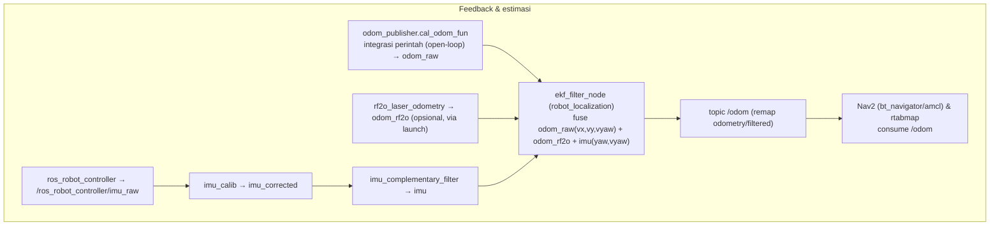

# Alur Kontrol ROS 2

> Checkpoint Phase 1–2: dokumen ini diperluas dengan dua jalur `cmd_vel`, jalur feedback
> odometri/IMU/EKF, dan antarmuka `cmd_vel` Nav2. Semua temuan statis (baca source).

## Pencarian referensi kode

### Command/Script
```bat
git grep -n -E "MecanumChassis|set_velocity|set_motor|cmd_vel" -- src
```

### Output
Potongan relevan:
```text
src/driver/controller/controller/odom_publisher_node.py:106: self.mecanum = mecanum.MecanumChassis(...)
src/driver/controller/controller/odom_publisher_node.py:138: self.motor_pub = self.create_publisher(MotorsState, 'ros_robot_controller/set_motor', 1)
src/driver/controller/controller/odom_publisher_node.py:142: self.create_subscription(Twist, 'controller/cmd_vel', self.cmd_vel_callback, 1)
src/driver/controller/controller/odom_publisher_node.py:246: speeds = self.mecanum.set_velocity(...)
src/driver/ros_robot_controller/ros_robot_controller/ros_robot_controller_node.py:48: self.create_subscription(MotorsState, '~/set_motor', self.set_motor_state, 10)
src/driver/ros_robot_controller/ros_robot_controller/ros_robot_controller_node.py:165: self.board.set_motor_speed(data)
```

### Kesimpulan
Alur umum yang didukung hasil pencarian:
```text
Sumber perintah gerak
  → Twist pada controller/cmd_vel
  → odom_publisher_node.py
  → MecanumChassis.set_velocity(...)
  → MotorsState berisi ID motor dan RPS
  → ros_robot_controller/set_motor
  → ros_robot_controller_node.py
  → set_motor_state(...)
  → Board.set_motor_speed(data)
```
Nama topik tanpa `/` di depan dapat dipengaruhi namespace, sehingga nama hasil resolusi runtime perlu diverifikasi.

## Antarmuka hardware

### Command/Script
```bat
type src\driver\ros_robot_controller\ros_robot_controller\ros_robot_controller_node.py
```

### Output
Dari isi file yang dibagikan: node membuat `Board()`, berlangganan `~/set_motor`, mengubah pesan `MotorsState` menjadi pasangan ID motor dan RPS, lalu memanggil `self.board.set_motor_speed(data)`. Node juga menerbitkan data IMU, joystick, tombol, SBUS, dan baterai.

### Kesimpulan
Node ini menjembatani pesan ROS 2 ke API SDK board. Detail protokol hardware perlu dibaca dari file SDK, bukan diasumsikan dari node ini.

## Dua jalur perintah `cmd_vel` (checkpoint Phase 2)

### Command/Script
```bat
grep -n "create_subscription(Twist\|cmd_vel\|app_cmd_vel_callback\|cmd_vel_callback" src/driver/controller/controller/odom_publisher_node.py
```

### Output
```text
142: self.create_subscription(Twist, 'controller/cmd_vel', self.cmd_vel_callback, 1)
144: self.create_subscription(Twist, 'cmd_vel', self.app_cmd_vel_callback, 1)
225: def app_cmd_vel_callback(self, msg):
240: def cmd_vel_callback(self, msg):
```

Isi `app_cmd_vel_callback` (baris 225–238): clamp `linear.x`, `linear.y`, `angular.z` ke ±0.2,
lalu memanggil `self.cmd_vel_callback(msg)`. Isi `cmd_vel_callback` (baris 240–289): memilih cabang
berdasarkan `self.machine_type`.

### Kesimpulan
- **Ada DUA subscription berbeda** pada node `odom_publisher`:
  - `controller/cmd_vel` (baris 142, relatif) tanpa clamp → dipakai teleop/keyboard/joystick,
    aplikasi `app/*`, dan contoh (`/controller/cmd_vel` absolut dari publisher lain).
  - `cmd_vel` (baris 144, relatif) **dengan clamp ±0.2** → dipakai output navigasi (lihat bagian Nav2).
- Keduanya adalah jalur yang **sah dan terpisah**; node menerima keduanya. `app_cmd_vel_callback`
  mendelegasikan ke `cmd_vel_callback` setelah clamp. `TERBUKTI DARI SOURCE`.
- **Catatan:** tidak ada bukti bahwa kedua topik dipublikasikan bersamaan; mana yang aktif
  bergantung komponen yang dijalankan. `BELUM TERVERIFIKASI` tanpa runtime.

## Cabang chassis yang benar-benar tersedia

### Command/Script
```bat
sed -n '240,289p' src/driver/controller/controller/odom_publisher_node.py
```

### Output
- `if 'Acker' not in self.machine_type:` → masuk blok roda-holonomik.
  - `if 'Mecanum' in self.machine_type:` → `self.mecanum.set_velocity(linear_x, linear_y, angular_z)`.
  - `elif 'Tank' in self.machine_type:` → `set_velocity(linear_x, 0.0, angular_z)` + koreksi
    `right_correction`/`left_correction` dari YAML.
  - `else:` (Ackermann) → `self.ackermann.set_velocity(...)` + publikasi PWM servo kemudi (id 3).
- Objek dibentuk: `ackermann.AckermannChassis(wheelbase=0.145, track_width=0.133, wheel_diameter=0.067)`
  (baris 104); `mecanum.MecanumChassis(wheelbase=0.1368, track_width=0.1446, wheel_diameter=0.065)`
  untuk Mecanum (baris 106) dan `0.068` untuk Tank (baris 108).

### Kesimpulan
Cabang chassis ditentukan oleh substring `machine_type`: `Mecanum`, `Tank`, atau Ackermann (else).
`TERBUKTI DARI SOURCE`. Cabang mana yang aktif bergantung env `MACHINE_TYPE` → `BELUM TERVERIFIKASI`.

## Resolusi nama topik `set_motor`

### Command/Script
```bat
grep -n "'ros_robot_controller/set_motor'\|'~/set_motor'\|executable=" src/driver/controller/controller/odom_publisher_node.py src/driver/ros_robot_controller/launch/ros_robot_controller.launch.py
```

### Output
- Publisher: `odom_publisher_node.py:138` → `create_publisher(MotorsState, 'ros_robot_controller/set_motor', 1)` (relatif).
- Subscriber: `ros_robot_controller_node.py:48` → `create_subscription(MotorsState, '~/set_motor', self.set_motor_state, 10)` (private → `/<node_name>/set_motor`).
- Node name: `ros_robot_controller.launch.py:10-15` tidak menetapkan `name=`/`namespace` → nama node = `ros_robot_controller`.

### Kesimpulan
Tanpa namespace, publisher relatif `ros_robot_controller/set_motor` dan subscriber private
`~/set_motor` **keduanya resolve ke `/ros_robot_controller/set_motor`** → cocok. `TERBUKTI DARI SOURCE`.
Bila `use_namespace:=true`/`PushRosNamespace` dipakai, keduanya relatif sehingga tetap selaras secara
statis, tetapi nama akhir bergantung namespace runtime → `BELUM TERVERIFIKASI`.

## Jalur feedback odometri, IMU, dan EKF (checkpoint Phase 2)

### Command/Script
```bat
grep -n "odom_raw\|odom0\|odom1\|imu0\|world_frame\|base_link_frame\|odom_frame\|map_frame" src/driver/controller/config/ekf.yaml
grep -n "imu_raw\|imu_corrected\|imu'\|raw\|corrected" src/peripherals/launch/imu_filter.launch.py
```

### Output
- `odom_publisher_node.py:133` menerbitkan `Odometry` ke `odom_raw` (hasil integrasi `linear_x`,
  `linear_y`, `angular_z`; lihat `cal_odom_fun` baris 291–325).
- `ekf.yaml`: `odom0: odom_raw`, `odom1: odom_rf2o`, `imu0: imu`; `world_frame`/`odom_frame` =
  `namespace/odom`, `base_link_frame` = `namespace/base_footprint`, `map_frame` = `namespace/map`.
  `odom0_config` hanya memakai vx, vy, vyaw (bukan pose); `imu0_config` memakai yaw + vyaw.
- `imu_filter.launch.py`: `imu_calib` remap `raw→/ros_robot_controller/imu_raw`, `corrected→imu_corrected`;
  `imu_complementary_filter` remap `/imu/data_raw→imu_corrected`, `imu/data→imu`.
- `controller.launch.py:73-78`: node `ekf_filter_node` remap `odometry/filtered→odom`,
  `cmd_vel→controller/cmd_vel`.

### Kesimpulan
- **Sumber data odometri (wheel):** perintah kecepatan diintegrasikan di `cal_odom_fun` (open-loop,
  **bukan** dari encoder) → `odom_raw`. `TERBUKTI DARI SOURCE`.
- **Sumber pose:** EKF `robot_localization` memadukan `odom_raw` (vx,vy,vyaw), `odom_rf2o` (pose x,y,yaw
  dari laser), dan `imu` (yaw, vyaw) → `odom`. `TERBUKTI DARI SOURCE` (dari `ekf.yaml` + remap launch).
- **Catatan penting:** odometri roda bersifat **open-loop** (mengintegrasikan perintah, bukan sensor
  encoder). Kontribusi sensor nyata datang dari IMU dan `odom_rf2o`. `TERBUKTI DARI SOURCE`.
- **IMU mentah** berasal dari `ros_robot_controller` (`~/imu_raw`), dikalibrasi+filtrasi menjadi `imu`.
- **Konsumsi `odom`:** Nav2 (`bt_navigator`/`amcl` `odom_topic: /odom`, `nav2_params.yaml`), dan
  `rtabmap` (remap `odom→/odom`). `TERBUKTI DARI SOURCE` (statis).
- **Yang belum terverifikasi:** ketersediaan driver `rf2o_laser_odometry`/`imu_calib`/
  `imu_complementary_filter`/`robot_localization` di robot sekolah, dan Tf runtime aktual.

## Antarmuka `cmd_vel` Nav2 (checkpoint Phase 2)

### Command/Script
```bat
grep -n "cmd_vel\|cmd_vel_nav" src/navigation/launch/include/navigation_base.launch.py
grep -n "odom_topic\|robot_base_frame\|scan_topic" src/navigation/config/nav2_params.yaml
```

### Output
```
navigation_base.launch.py:97:  controller_server remap 'cmd_vel' → 'cmd_vel_nav'
navigation_base.launch.py:134: velocity_smoother remap 'cmd_vel'→'cmd_vel_nav', 'cmd_vel_smoothed'→'cmd_vel'
nav2_params.yaml:59-60:       robot_base_frame: base_footprint ; odom_topic: /odom
nav2_params.yaml:37:          scan_topic: scan_raw
```

### Kesimpulan
- `ControllerServer` menerbitkan ke `cmd_vel_nav` (bukan `cmd_vel` langsung).
- `VelocitySmoother` membaca `cmd_vel_nav` dan menerbitkan laju halus ke `cmd_vel`.
- Node `odom_publisher` berlangganan `cmd_vel` (baris 144) → **rantai Nav2 → roda terbukti statis:**
  `nav2_controller → cmd_vel_nav → velocity_smoother → cmd_vel → odom_publisher.app_cmd_vel_callback`
  (clamp ±0.2) → `cmd_vel_callback` → `MecanumChassis.set_velocity` → `MotorsState` → `/ros_robot_controller/set_motor`.
  `TERBUKTI DARI SOURCE`.
- `scan_topic: scan_raw` konsisten dengan `lidar.launch.py` yang meremap `scan→scan_raw`.
- Pengaruh namespace: seluruh remap memakai nama relatif; dengan `use_namespace:=true` semuanya
  bergeser bersama, tetapi nama akhir runtime `BELUM TERVERIFIKASI`.
- **Batas cakupan:** algoritma Nav2 (costmap/planner/BT/SLAM/obstacle avoidance) tidak diaudit di sini;
  itu masuk Phase 3.

## Diagram alur (hanya relasi yang terbukti dari source)

```mermaid
flowchart TD
    subgraph CMD["Perintah gerak"]
        TELEOP["teleop/joystick/app\npublish Twist → /controller/cmd_vel"]
        NAV["Nav2 controller_server\npublish cmd_vel_nav"]
        VS["nav2_velocity_smoother\npublish cmd_vel"]
        NAV --> VS
    end

    OP["odom_publisher (node controller)\nsub: controller/cmd_vel & cmd_vel"]
    TELEOP -->|Twist| OP
    VS -->|Twist (clamp ±0.2)| OP

    KIN["cmd_vel_callback → cabang machine_type\nMecanumChassis.set_velocity()"]
    OP --> KIN

    MS["MotorsState (id 1..4, rps)"]
    KIN --> MS

    MSG["topic /ros_robot_controller/set_motor"]
    MS --> MSG

    RRC["ros_robot_controller node\nsub ~/set_motor → set_motor_state"]
    MSG --> RRC

    BOARD["Board.set_motor_speed([[id,rps],...])"]
    RRC --> BOARD
```


