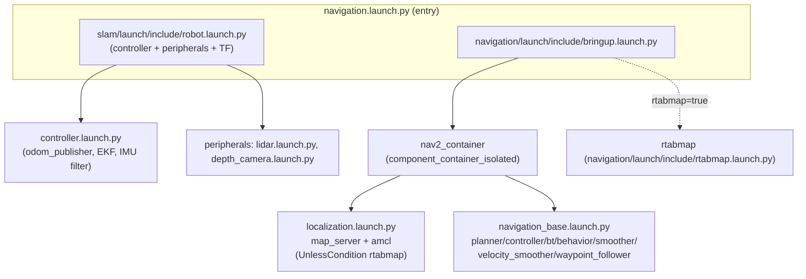
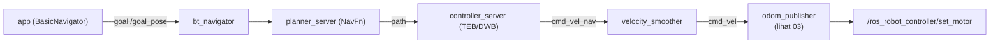

# Arsitektur Navigasi (Phase 3)

> Audit statis. Semua temuan dari pembacaan source. Tidak ada node dijalankan, tidak ada
> pengujian runtime. Label: `TERBUKTI DARI SOURCE`, `INFERENSI`, `BELUM TERVERIFIKASI`.
>
> Konteks: Phase 1–2 (lihat `00`–`04`) sudah memetakan jalur perintah→motor dan feedback.
> Dokumen ini fokus pada **arsitektur navigasi Nav2** sebagai fondasi obstacle avoidance.

## Titik masuk navigasi

### Command/Script
```bat
type src\navigation\launch\navigation.launch.py
```

### Output
- Default argumen (baris 19–23): `sim=false`, `map=map_01`, `robot_name=os.environ['HOST']`,
  `master_name=os.environ['MASTER']`, **`use_teb=true`**.
- Pemilihan params (baris 35–39): `machine_type=='LanderPi_Acker'` → `config/nav2_params_ack.yaml`,
  else → `config/nav2_params.yaml`.
- Komposisi (baris 41–72): `base_launch` = `slam/launch/include/robot.launch.py` (controller+peripherals);
  `navigation_launch` = `navigation/launch/include/bringup.launch.py` dengan `map=slam/maps/<map>.yaml`,
  `namespace=robot_name`, `use_teb`.
- Urutan: `PushRosNamespace(robot_name)` → base_launch → `TimerAction(period=10.0)` → navigation_launch.

### Kesimpulan
- `TERBUKTI DARI SOURCE`: `navigation.launch.py` adalah entry point; default controller = **TEB**
  (karena `use_teb=true`), bukan DWB. DWB hanya dipilih jika `use_teb:=false`.
- `naspace` = nilai `HOST`; `master_name` dari `MASTER`. → `BELUM TERVERIFIKASI` (env di luar repo).
- `INFERENSI`: TimerAction 10 s menunda nav2 agar TF/odom/sensor sudah siap — pola umum, tetapi
  timeout bukan bukti runtime berhasil.

## Node Nav2 yang dikomposisikan (lifecycle)

### Command/Script
```bat
type src\navigation\launch\include\navigation_base.launch.py
```

### Output
- `lifecycle_nodes` (baris 28–34): `controller_server`, `smoother_server`, `planner_server`,
  `behavior_server`, `bt_navigator`, `waypoint_follower`, `velocity_smoother`.
- `LoadComposableNodes` ke `nav2_container` (baris 89–143):
  - `controller_server` (plugin `nav2_controller::ControllerServer`, remap `cmd_vel`→`cmd_vel_nav`)
  - `smoother_server`, `planner_server`, `behavior_server`, `bt_navigator`, `waypoint_follower`
  - `velocity_smoother` (remap `cmd_vel`→`cmd_vel_nav`, `cmd_vel_smoothed`→`cmd_vel`)
  - `lifecycle_manager_navigation` (`node_names` = `lifecycle_nodes`, `autostart`)
- Pemilihan controller config (baris 80–86): `use_teb=true` + `LanderPi_Acker` → `nav2_controller_teb_ack.yaml`;
  `use_teb=true` lainnya → `nav2_controller_teb.yaml`; else → `nav2_controller_dwb.yaml`.

### Kesimpulan
- `TERBUKTI DARI SOURCE`: 8 komponen Nav2 dimuat sebagai composable nodes dalam satu container,
  dikelola dua lifecycle manager. Controller default = TEB.
- **Catatan kritis**: TEB memerlukan paket eksternal `teb_local_planner` (bukan bagian Nav2 standar).
  Tidak dideklarasikan di `package.xml` mana pun → `BELUM TERVERIFIKASI` apakah terpasang di robot.

## Localization (map_server + AMCL)

### Command/Script
```bat
type src\navigation\launch\include\localization.launch.py
```

### Output
- `lifecycle_nodes = ['map_server', 'amcl']` (baris 21).
- `nav2_map_server::MapServer` dengan `yaml_filename: map_yaml_file` (baris 68–73).
- `nav2_amcl::AmclNode` (baris 74–79).
- `lifecycle_manager_localization` (baris 80–86).
- Di `bringup.launch.py` (baris 89–96): localization di-include dengan
  `condition=UnlessCondition(rtabmap)` → localization aktif hanya bila `rtabmap=false`.

### Kesimpulan
- `TERBUKTI DARI SOURCE`: mode navigasi peta 2D = `map_server` + `amcl` + lifecycle manager.
  Bila dijalankan lewat `rtabmap_navigation.launch.py` (`rtabmap:=true`), localization AMCL **tidak**
  dimuat (digantikan rtabmap).
- `BELUM TERVERIFIKASI`: apakah `nav2_map_server`/`nav2_amcl` terpasang & map dapat dimuat di robot.

## Topology dan node roles (dari config + launch)

| Node | Plugin/Peran | Config sumber | Terbukti |
|---|---|---|---|
| `controller_server` | `nav2_controller::ControllerServer` (follow path) | `nav2_controller_{dwb,teb,teb_ack}.yaml` | Source + launch |
| `planner_server` | `nav2_planner::PlannerServer` (global path) | `nav2_params.yaml` | Source + launch |
| `smoother_server` | `nav2_smoother::SmootherServer` | `nav2_params.yaml` | Source + launch |
| `behavior_server` | `behavior_server::BehaviorServer` (recovery) | `nav2_params.yaml` | Source + launch |
| `bt_navigator` | `nav2_bt_navigator::BtNavigator` (orkestrasi) | `nav2_params.yaml` | Source + launch |
| `waypoint_follower` | `nav2_waypoint_follower::WaypointFollower` | `nav2_params.yaml` | Source + launch |
| `velocity_smoother` | `nav2_velocity_smoother::VelocitySmoother` | `nav2_params.yaml` | Source + launch |
| `map_server` | `nav2_map_server::MapServer` | `nav2_params.yaml` + map yaml | Source + launch |
| `amcl` | `nav2_amcl::AmclNode` | `nav2_params.yaml` | Source + launch |

> Kolom "Terbukti" = *Present in source* dan *Connected through launch*. **Bukan** bukti runnable/
> bekerja di robot.

## Parameter kunci navigasi

### Command/Script
```bat
sed -n '55,72p;131,172p;181,214p;222,316p' src\navigation\config\nav2_params.yaml
```

### Output
- `bt_navigator`: `global_frame: map`, `robot_base_frame: base_footprint`, `odom_topic: /odom`,
  `default_nav_to_pose_bt_xml: .../navigate_to_pose_without_backup.xml`,
  `default_nav_through_poses_bt_xml: .../navigate_without_backup.xml` (hardcoded path `/home/ubuntu/...`).
- `map_server`: `yaml_filename: ""` (diisi oleh launch).
- `amcl`: `base_frame_id: base_footprint`, `odom_frame_id: odom`, `global_frame_id: map`,
  `scan_topic: scan_raw`, `robot_model_type: nav2_amcl::DifferentialMotionModel`,
  `set_initial_pose: True`, `initial_pose: {x:0,y:0,yaw:0}`.
- `planner_server`: `planner_plugins: ["GridBased"]`, `GridBased.plugin: nav2_navfn_planner/NavfnPlanner`,
  `use_astar: false`, `allow_unknown: true`, `tolerance: 0.5`.
- `smoother_server`: `simple_smoother` (`nav2_smoother::SimpleSmoother`, `max_its: 1000`).
- `behavior_server`: `behavior_plugins: ["spin","drive_on_heading","assisted_teleop","wait"]`
  (**`backup` dikomentari**), `global_frame: odom`, `max_rotational_vel: 3.0`.
- `velocity_smoother`: `feedback: OPEN_LOOP`, `max_velocity: [0.26,0.0,3.0]`, `odom_topic: odom`.
- `waypoint_follower`: `waypoint_task_executor_plugin: wait_at_waypoint` (`waypoint_pause_duration: 200`).

### Kesimpulan
- `TERBUKTI DARI SOURCE`: planner = **NavFn** (Dijkstra, karena `use_astar=false`) dengan
  `allow_unknown=true`; AMCL memakai model `DifferentialMotionModel`; recovery server **tanpa backup**.
- `INFERENSI`: `DifferentialMotionModel` pada AMCL + controller tanpa lateral (lihat `06`) = Nav2
  diperlakukan sebagai robot **diferensial**, meski base mecanum. Konsekuensi di `08`.
- **Path BT XML hardcoded** ke `/home/ubuntu/ros2_ws/...` → portabilitas terbatas. `TERBUKTI DARI SOURCE`.

## Costmap (ringkas; detail di `06`)

### Command/Script
```bat
sed -n '131,214p' src\navigation\config\nav2_params.yaml
```

### Output
- `local_costmap` (`global_frame: odom`, `rolling_window: true`, 3×3 m, `resolution 0.05`):
  `robot_radius: 0.10`, `plugins: ["voxel_layer","inflation_layer"]`, `voxel_layer` sumber `scan`
  (`topic: /scan_raw`, `LaserScan`, marking+clearing, `obstacle_max_range: 2.5`),
  `inflation_layer` (`inflation_radius: 0.16`, `cost_scaling_factor: 1.8`).
- `global_costmap` (`global_frame: map`): `robot_radius: 0.10`,
  `plugins: ["static_layer","obstacle_layer","inflation_layer"]`, `obstacle_layer` sumber `scan`
  (`/scan_raw`), `inflation_layer` (`inflation_radius: 0.16`, `cost_scaling_factor: 2.0`),
  `track_unknown_space: true`.
- **Anomali**: `local_costmap` memiliki blok `static_layer` (baris 169–171) tetapi `static_layer`
  **tidak** ada di daftar `plugins` (baris 144) → blok tersebut tidak aktif.

### Kesimpulan
- `TERBUKTI DARI SOURCE`: local costmap 3×3 m memakai voxel layer (3D) dari LiDAR; global costmap
  memakai obstacle layer 2D + static map. `robot_radius: 0.10` (radius 10 cm).
- `INFERENSI`: local costmap mengabaikan static layer (blok tak terdaftar) — relevan bila ingin
  menghindari obstacle statis yang diketahui di lintasan lokal.

## Behavior tree & recovery

### Command/Script
```bat
type src\navigation\config\behavior_trees\navigate_to_pose_without_backup.xml
```

### Output
- `RecoveryNode number_of_retries="6" name="NavigateRecovery"`.
- `RateController hz="1.0"` menghitung ulang path tiap 1 Hz.
- `FollowPath ... controller_id="FollowPath"`; bila gagal → `ClearEntireCostmap` lokal.
- `RecoveryFallback`: `GoalUpdated` → `RoundRobin`(`ClearEntireCostmap` lokal+global, `Spin spin_dist=1.57`,
  `Wait wait_duration=5`). **`BackUp` dikomentari** (baris 31).
- Varian `_ack.xml`: `Spin` dikomentari, `BackUp backup_dist=0.30` aktif (lihat `09`/`08`).

### Kesimpulan
- `TERBUKTI DARI SOURCE`: recovery mecanum = clear costmap + spin + wait (tanpa backup).
  Varian Ackermann = clear + wait + backup (tanpa spin).
- `INFERENSI`: konsisten dengan behavior_server yang mengomentari plugin `backup` pada config mecanum.

## Antarmuka aplikasi → Nav2

### Command/Script
```bat
grep -n "BasicNavigator\|nav2_simple_commander\|goal_pose\|navigate" src\example\example\navigation_transport\navigation_transport.py
```

### Output
- `from nav2_simple_commander.robot_navigator import BasicNavigator, TaskResult` (baris 19).
- `self.navigator = BasicNavigator()` (baris 33); publish goal ke `/goal_pose` (baris 39–40, 217);
  service `automatic_pick/pick`/`place` via `Trigger` (baris 48–49).

### Kesimpulan
- `TERBUKTI DARI SOURCE`: aplikasi transport mengirim goal navigasi via **`nav2_simple_commander`**
  (BasicNavigator) dan `/goal_pose` — cara termudah menggerakkan base melalui Nav2.
- `BELUM TERVERIFIKASI`: apakah paket `nav2_simple_commander` terpasang; perilaku runtime.

## Diagram arsitektur (relasi terbukti dari source)





## Yang belum diketahui
- `BELUM TERVERIFIKASI`: apakah `teb_local_planner`, `nav2_*`, `slam_toolbox`, `rtabmap`,
  `nav2_simple_commander` terpasang di robot sekolah.
- `BELUM TERVERIFIKASI`: nilai `HOST`/`MASTER` (namespace) di robot sekolah.
- `BELUM TERVERIFIKASI`: apakah stack benar-benar mencapai status active lifecycle pada hardware.
