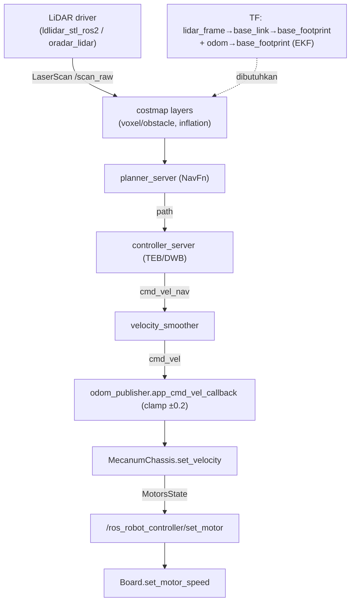

# Obstacle Avoidance (Phase 3)

> Audit statis. Label: `TERBUKTI DARI SOURCE`, `INFERENSI`, `BELUM TERVERIFIKASI`.
> Membedakan dua jalur avoidance yang **independen**: (A) Nav2 costmap-based, (B) app reaktif berbasis LiDAR.

## Ringkasan dua jalur avoidance

Ada **dua mekanisme berbeda** di repository:
1. **Nav2 costmap-based** (jalur otonom): LiDAR → costmap layer → planner/controller → `cmd_vel`.
2. **App reaktif** (`app/lidar_controller.py`): LiDAR → PID/threshold → `/controller/cmd_vel`
   (tidak lewat costmap/Nav2).

Keduanya **tidak** dihubungkan satu sama lain (menulis ke topik `cmd_vel` yang berbeda).

## Jalur sensor LiDAR → topik

### Command/Script
```bat
type src\peripherals\launch\lidar.launch.py
type src\peripherals\launch\include\ldlidar_LD19.launch.py
type src\peripherals\launch\include\ms200_scan.launch.py
```

### Output
- `lidar.launch.py` memilih driver via `os.environ['LIDAR_TYPE']` (baris 13): `MS200`/`LD19` → LD19
  launch; `A1`/`G4`/`LD14P` → filter berbeda; else → MS200.
- `ldlidar_LD19.launch.py`: `package='ldlidar_stl_ros2'`, `executable='ldlidar_stl_ros2_node'`,
  param `topic_name: 'scan'`, `frame_id: lidar_frame`, `port_name: /dev/ldlidar`,
  `remappings=[('scan', scan_raw)]`.
- `ms200_scan.launch.py`: `package='oradar_lidar'`, `executable='oradar_scan'`,
  param `scan_topic: MS200/scan`, `frame_id: lidar_frame`, `remappings=[('/MS200/scan', scan_raw)]`.
- Node filter `laser_filters/scan_to_scan_filter_chain` (remap `scan→scan_raw`, `scan_filtered→scan`)
  **didefinisikan tetapi dikomentari** dari daftar aktif (baris 66).

### Kesimpulan
- `TERBUKTI DARI SOURCE`: driver LiDAR mempublikasikan **`scan_raw`** (`LaserScan`), frame `lidar_frame`.
  Dua driver konkret: `ldlidar_stl_ros2` (LD19) dan `oradar_lidar` (MS200).
- `BELUM TERVERIFIKASI`: driver mana yang aktif (`LIDAR_TYPE` di luar repo).
- `TERBUKTI DARI SOURCE`: filter LiDAR **tidak aktif** (dikomentari) → tidak ada praproses scan default.

## Konsumsi `scan_raw` oleh costmap

### Command/Script
```bat
sed -n '144,172p;192,206p' src\navigation\config\nav2_params.yaml
```

### Output
- Local costmap `voxel_layer` (baris 149–168): `observation_sources: scan`, `scan.topic: /scan_raw`,
  `data_type: "LaserScan"`, `marking: True`, `clearing: True`, `max_obstacle_height: 2.0`,
  `raytrace_max_range: 3.0`, `obstacle_max_range: 2.5`, `origin_z: 0.0`, `z_voxels: 16`,
  `z_resolution: 0.03`.
- Global costmap `obstacle_layer` (baris 193–206): `scan.topic: /scan_raw`, `LaserScan`,
  marking+clearing, `raytrace_max_range: 3.0`, `obstacle_max_range: 2.5`.

### Kesimpulan
- `TERBUKTI DARI SOURCE`: kedua costmap mengonsumsi `/scan_raw` sebagai `LaserScan`.
  Local memakai **VoxelLayer** (3D, `publish_voxel_map: True`); global memakai **ObstacleLayer** (2D).
- `INFERENSI`: karena local memakai voxel layer dengan `max_obstacle_height: 2.0`, ketinggian obstacle
  diperhitungkan; namun sumber hanya scan 2D (satu bidang tinggi) → voxel 3D saat ini praktis setara
  satu bidang scan. (Perlu konfirmasi tinggi pemasangan LiDAR.)
- `BELUM TERVERIFIKASI`: apakah `/scan_raw` benar-benar mengalir saat runtime (kesesuaian frame/TF).

## Rantai lengkap sensor → motor (Nav2)

### Command/Script
```bat
grep -n "cmd_vel\|cmd_vel_nav\|odom_topic\|scan_topic" src\navigation\launch\include\navigation_base.launch.py src\navigation\config\nav2_params.yaml
```

### Output
```
navigation_base.launch.py:97  controller_server remap 'cmd_vel' -> 'cmd_vel_nav'
navigation_base.launch.py:134 velocity_smoother remap 'cmd_vel'->'cmd_vel_nav', 'cmd_vel_smoothed'->'cmd_vel'
nav2_params.yaml:40  amcl.scan_topic: scan_raw
nav2_params.yaml:60  bt_navigator.odom_topic: /odom
nav2_params.yaml:313 velocity_smoother.odom_topic: odom
```

### Output (Phase 1–2, sudah diverifikasi)
- `odom_publisher_node.py:144` subscribe `cmd_vel` → `app_cmd_vel_callback` (clamp ±0.2) → `cmd_vel_callback`.
- `odom_publisher_node.py:246` `MecanumChassis.set_velocity()` → `MotorsState` → `:138` publish
  `ros_robot_controller/set_motor` → `ros_robot_controller_node.py:165` `Board.set_motor_speed()`.

### Kesimpulan
- `TERBUKTI DARI SOURCE` untuk setiap edge statis:
  `LiDAR → /scan_raw → costmap layer → planner_server → controller_server → cmd_vel_nav →
  velocity_smoother → cmd_vel → odom_publisher → MecanumChassis.set_velocity → MotorsState →
  /ros_robot_controller/set_motor → Board.set_motor_speed()`.
- **Urutan consumer `cmd_vel`:** `velocity_smoother` mempublikasikan `cmd_vel` (dari `cmd_vel_smoothed`),
  dan `odom_publisher` berlangganan `cmd_vel`. → `INFERENSI` kuat: ini jalur nav→motor.
- `BELUM TERVERIFIKASI`: perilaku runtime (topik benar-benar terhubung, TF tersedia, obstacle terdeteksi).

## Parameter avoidance material

### Command/Script
```bat
sed -n '143,148p;189,213p;303,316p' src\navigation\config\nav2_params.yaml
sed -n '33,88p' src\navigation\config\nav2_controller_dwb.yaml
```

### Output
- `robot_radius: 0.10` (kedua costmap).
- `inflation_radius: 0.16` (local & global); `cost_scaling_factor`: local `1.8`, global `2.0`.
- `voxel_layer.obstacle_max_range: 2.5`, `raytrace_max_range: 3.0`.
- `velocity_smoother.max_velocity: [0.26, 0.0, 3.0]`; `feedback: OPEN_LOOP`.
- DWB (jika `use_teb:=false`): `max_vel_x: 0.4`, **`min_vel_y: 0.0`, `max_vel_y: 0.0`, `vy_samples: 1`**,
  `max_vel_theta: 3.0`, `critics: [..., "BaseObstacle", ...]`, `BaseObstacle.scale: 0.02`.
- TEB (default): `min_obstacle_dist: 0.25`, `inflation_dist: 0.0`, `include_costmap_obstacles: True`,
  `footprint_model: {type: circular, radius: 0.05}`, `weight_obstacle: 300.0`.

### Kesimpulan
- `TERBUKTI DARI SOURCE`:
  - **DWB & TEB sama-sama menonaktifkan gerak lateral** (`max_vel_y: 0.0` pada DWB; TEB tidak
    memiliki parameter `vy`). → Nav2 menggerakkan mecanum seperti robot **diferensial**.
  - `robot_radius 0.10` < `inflation_radius 0.16` → margin inflasi 6 cm.
  - TEB `footprint_model radius 0.05` (5 cm) **berbeda** dari `robot_radius 0.10` (10 cm) → inkonsistensi
    geometri antar komponen.
- `INFERENSI`: karena tidak ada gerak lateral, kemampuan strafing mecanum tidak dimanfaatkan oleh
  stack terkonfigurasi. Ini kehilangan keunggulan platform.
- `BELUM TERVERIFIKASI`: apakah `robot_radius 0.10` cukup aman untuk chassis fisik (tergantung dimensi).

## Jalur avoidance reaktif (app, di luar Nav2)

### Command/Script
```bat
type src\app\app\lidar_controller.py
```

### Output
- Subscriber `LaserScan /scan_raw` dengan QoS `BEST_EFFORT` (baris 85).
- Publisher `Twist /controller/cmd_vel` (baris 51).
- Mode (service `~/set_running`, `SetInt64`): `1`=obstacle avoidance, `2`=following, `3`=guarding (baris 103).
- Parameter (baris 38–40, 120–147): `threshold` (0.3–1.5 m, default 0.6), `scan_angle` (0–90°),
  `speed` (default 0.2).
- Logika mode 1 (baris 178–220): hitung `min_dist_left`/`min_dist_right` dari `angle_increment`,
  lalu bila ada obstacle → putar (angular.z ±`speed*6`), bila bebas → lurus (`linear.x = speed`).
  Kelas `MAX_SCAN_ANGLE` = 240° (non-Pro) / 120° (Pro) (baris 25–28).
- Mode 2/3: PID (`pid.PID(1.6,0,0.16)` yaw, `pid.PID(1.7,0,0.16)` dist) untuk following/guarding.

### Kesimpulan
- `TERBUKTI DARI SOURCE`: avoidance reaktif berbasis threshold+PID, menerbitkan ke
  `/controller/cmd_vel` (jalur **tanpa clamp** dari Phase 1–2), independen dari costmap/Nav2.
- `INFERENSI`: ini solusi "avoidance minimal" yang tidak butuh peta/Nav2 — berguna sebagai fallback
  atau tahap awal pada robot kustom.
- `BELUM TERVERIFIKASI`: efektivitas runtime (kecepatan reaksi, tuning PID) pada hardware.

## Contoh avoidance lain (berbasis kamera)

### Command/Script
```bat
grep -n "create_subscription\|create_publisher\|cmd_vel\|threshold\|stop" src\example\example\line_follow_clean\line_follow_clean_node.py
grep -n "create_subscription\|create_publisher\|cmd_vel\|yolo\|ascamera" src\example\example\self_driving\self_driving.py
```

### Output
- `line_follow_clean_node.py`: sub `LaserScan /scan_raw` (baris 63), `stop_threshold=0.4` (baris 48);
  obstacle dalam `stop_threshold` → berhenti; pub `Twist /controller/cmd_vel` (baris 64);
  juga sub `/color_detect/color_info` (baris 65).
- `self_driving.py`: sub `Image /ascamera/camera_publisher/rgb0/image` (baris 160),
  `ObjectsInfo /yolo_node/object_detect` (baris 161); pub `Twist /controller/cmd_vel` (baris 52).

### Kesimpulan
- `TERBUKTI DARI SOURCE`: dua pola avoidance sample — (a) LiDAR threshold stop, (b) kamera+YOLO.
  Keduanya menulis `/controller/cmd_vel`, bukan costmap.
- `BELUM TERVERIFIKASI`: ketersediaan `/yolo_node/object_detect` dan kamera pada robot sekolah.

## Full sensor→motor diagram (jalur Nav2; edge terbukti)



## Edge yang belum terbukti (tidak dikarang)
- `BELUM TERVERIFIKASI`: `/scan_raw` benar-benar tiba dengan frame `lidar_frame` dan TF-nya lengkap.
- `BELUM TERVERIFIKASI`: obstacle benar-benar ter-marking di costmap (butuh runtime).
- `BELUM TERVERIFIKASI`: `velocity_smoother` benar-benar menerima `cmd_vel_nav` & menerbitkan `cmd_vel`
  (butuh runtime); secara statis remap konsisten.
- `BELUM TERVERIFIKASI`: apakah Nav2 dan `lidar_controller` reaktif pernah dijalankan bersamaan
  (berpotensi konflik di `/controller/cmd_vel`).
