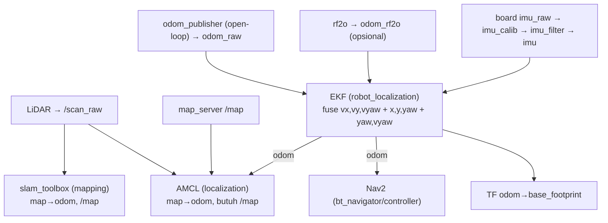

# Mapping & Localization (Phase 3)

> Audit statis. Label: `TERBUKTI DARI SOURCE`, `INFERENSI`, `BELUM TERVERIFIKASI`.
> Melanjutkan temuan Phase 1–2 (`03_ALUR_KONTROL_ROS2.md`): `odom_raw` = integrasi perintah (open-loop),
> bukan encoder.

## Komponen mapping & localization

### Command/Script
```bat
git ls-files src/slam/
grep -n "slam_toolbox\|rtabmap\|amcl\|map_server" -r src/slam src/navigation --include=*.py --include=*.yaml --include=*.xml
```

### Output
- **SLAM 2D**: `src/slam/launch/include/slam_base.launch.py` → `slam_toolbox` (`sync_slam_toolbox_node`),
  config `src/slam/config/slam.yaml`.
- **Localization peta 2D**: `src/navigation/launch/include/localization.launch.py` → `nav2_map_server` + `nav2_amcl`.
- **SLAM/Nav 3D**: `src/slam/launch/rtabmap_slam.launch.py` + `src/navigation/launch/rtabmap_navigation.launch.py`
  → `rtabmap_sync/rgbd_sync` + `rtabmap_slam/rtabmap`.
- **Map save**: `src/slam/slam/map_save.py` (service `/slam_toolbox/save_map` → `map_saver_cli`).

### Kesimpulan
- `TERBUKTI DARI SOURCE`: tiga jalur (slam_toolbox 2D, AMCL 2D, rtabmap 3D). Ini **present in source**
  dan **connected through launch**; **bukan** bukti runnable.

## SLAM 2D (slam_toolbox)

### Command/Script
```bat
type src\slam\config\slam.yaml
type src\slam\launch\include\slam_base.launch.py
```

### Output
- Config: `odom_frame: odom`, `map_frame: map`, `base_frame: base_footprint`, `scan_topic: scan_raw`,
  `mode: mapping`, `resolution: 0.05`, `max_laser_range: 12.0`, `use_scan_matching: true`,
  `do_loop_closing: true`, `transform_publish_period: 0.01`.
- Launch: `sync_slam_toolbox_node`, remap `/tf→tf`, `/tf_static→tf_static`, `/map→map`,
  `/map_metadata→map_metadata`; `enable_save=false` menambah remap `/slam_toolbox/save_map→/save_map`.
- `slam.launch.py` meng-include `slam_base.launch.py` dengan `scan_topic=f'{frame_prefix}scan_raw'`.

### Kesimpulan
- `TERBUKTI DARI SOURCE`: SLAM 2D = slam_toolbox, konsumsi `scan_raw`, frame standar
  (`odom`/`map`/`base_footprint`). Mode `mapping`.
- `BELUM TERVERIFIKASI`: apakah slam_toolbox terpasang & SLAM menghasilkan peta benar di hardware.

## Localization 2D (AMCL)

### Command/Script
```bat
sed -n '1,45p' src\navigation\config\nav2_params.yaml
```

### Output
- `amcl`: `base_frame_id: base_footprint`, `odom_frame_id: odom`, `global_frame_id: map`,
  `scan_topic: scan_raw`, `robot_model_type: nav2_amcl::DifferentialMotionModel`,
  `laser_model_type: likelihood_field`, `laser_max_range: 10.0`, `set_initial_pose: True`,
  `initial_pose: {x:0.0, y:0.0, yaw:0.0}`, `tf_broadcast: true`.
- Partikel: `min_particles: 500`, `max_particles: 3000`.

### Kesimpulan
- `TERBUKTI DARI SOURCE`: AMCL mengonsumsi `scan_raw`, mempublikasikan TF `map→odom`
  (`tf_broadcast: true`). Model motion = **DifferentialMotionModel**.
- `INFERENSI`: `DifferentialMotionModel` mengasumsikan robot diferensial (tidak ada lateral) —
  konsisten dengan controller tanpa `vy`. Untuk mecanum yang strafing, model ini **tidak akurat**,
  tetapi karena stack tidak memakai lateral (lihat `06`), inkonsistensinya kecil.
- `BELUM TERVERIFIKASI`: kualitas lokalisasi (butuh peta + LiDAR nyata).

## Odometri & feedback (dari Phase 1–2)

### Command/Script
```bat
sed -n '78,91p;132,140p;163,171p' src\driver\controller\config\ekf.yaml
sed -n '291,325p' src\driver\controller\controller\odom_publisher_node.py
```

### Output
- `ekf.yaml`: `odom0: odom_raw` (config = vx,vy,vyaw saja), `odom1: odom_rf2o` (pose x,y,yaw,
  `relative: true`), `imu0: imu` (yaw,vyaw). Frame `namespace/odom`, `namespace/base_footprint`,
  `namespace/map`; `world_frame: namespace/odom`.
- `odom_publisher_node.py.cal_odom_fun` (291–325): `delta_x = linear_x*dt*cos(pose_yaw)`, dst — **integrasi
  perintah kecepatan**, **tanpa** pembacaan encoder.
- `controller.launch.py`: EKF remap `odometry/filtered→odom`.

### Kesimpulan
- `TERBUKTI DARI SOURCE`: `odom_raw` = open-loop (integrasi perintah). Sensor nyata =
  `imu` (dari board) + `odom_rf2o` (laser odometry, opsional via launch).
- `INFERENSI (penting)`: karena `odom_raw` open-loop, **slip roda tidak terukur**; drift odometri
  roda besar saat beban/permukaan tidak ideal. EKF mengoreksi dengan IMU yaw + rf2o, tetapi rf2o
  hanya berjalan bila `rf2o_laser_odometry` dilaunch (lihat `rf2o_laser_odometry.launch.py`; bukan
  bagian dari `controller.launch.py` default). → **`BELUM TERVERIFIKASI`** apakah rf2o aktif di robot.
- Implikasi navigasi: tanpa rf2o, `odom` sangat bergantung IMU (yaw) + integrasi perintah →
  `map→odom` AMCL akan sering mengoreksi, dan path bisa tidak stabil. Diberi label **INFERENSI**
  sampai diukur.

## TF relationships

### Command/Script
```bat
grep -rn "link name=\|parent link\|child link" src\simulations\landerpi_description\urdf\mecanum.xacro src\simulations\landerpi_description\urdf\lidar.urdf.xacro src\simulations\landerpi_description\urdf\imu.urdf.xacro
grep -n "robot_state_publisher\|xacro\|frame_prefix" src\simulations\landerpi_description\launch\robot_description.launch.py
```

### Output
- URDF mecanum: `base_footprint → (fixed) → base_link`; `lidar_frame` child of `lidar_link`
  (origin `xyz=0 0 0, rpy=0 0 pi`); `imu_link` child of `base_link` (rpy `0 0 -pi/2`).
- `robot_description.launch.py`: `xacro urdf/landerpi.xacro` → `robot_state_publisher`
  (param `robot_description`, `frame_prefix`).

### Output (dari konfigurasi runtime)
- AMCL: `map→odom` (`tf_broadcast: true`).
- EKF: `odom→base_footprint` (publish_tf true, `world_frame=odom`).
- `robot_state_publisher` + URDF: `base_footprint→base_link→{lidar_frame, imu_link, wheels}`.
- SLAM (slam_toolbox): `map→odom` (mode mapping, `transform_publish_period: 0.01`).

### Kesimpulan
- `TERBUKTI DARI SOURCE`: rantai TF lengkap secara statis:
  `map → odom → base_footprint → base_link → {lidar_frame, imu_link}`.
  Penyedia: AMCL/slam_toolbox (`map→odom`), EKF (`odom→base_footprint`), RSP/URDF (sisanya).
- **Kritis**: semua produsen `map→odom` (AMCL **atau** slam_toolbox) **tidak boleh** aktif bersamaan.
  `TERBUKTI DARI SOURCE`: `bringup.launch.py` hanya memuat AMCL bila `rtabmap=false`; SLAM dan
  navigation dijalankan sebagai launch terpisah → konflik dicegah secara operasional, bukan inheren.
- `BELUM TERVERIFIKASI`: `frame_prefix`/namespace aktual & apakah TF utuh saat runtime.

## Map save/load

### Command/Script
```bat
type src\slam\slam\map_save.py
git ls-files src/slam/maps/
type src/slam/maps/map_01.yaml
```

### Output
- `map_save.py`: service `/slam_toolbox/save_map` → `os.system("cd ~/ros2_ws/src/slam/maps && ros2 run
  nav2_map_server map_saver_cli -f map_01 ...")`.
- `src/slam/maps/` berisi `map_01.pgm`, `map_01.yaml`, `.gitignore`.
- `navigation.launch.py` memuat map via `os.path.join(slam_package_path,'maps', map_name+'.yaml')`.

### Kesimpulan
- `TERBUKTI DARI SOURCE`: peta disimpan ke `map_01` (nama **hardcoded** di `map_save.py`), dimuat
  lewat argumen `map:=`.
- `INFERENSI`: `map_save.py` meng-hardcode nama file (`map_01`) → fleksibilitas rendah; tidak masalah
  untuk single-map.

## Diagram mapping/localization (relasi terbukti)



## Batasan & yang belum terverifikasi
- `BELUM TERVERIFIKASI`: pemasangan & konfigurasi `slam_toolbox`, `rtabmap`, `robot_localization`,
  `imu_calib`, `imu_complementary_filter`, `rf2o_laser_odometry` di robot sekolah.
- `BELUM TERVERIFIKASI`: apakah `odom_rf2o` benar-benar dipublikasikan (menentukan kualitas `odom`).
- `INFERENSI`: drift odometri signifikan karena `odom_raw` open-loop; perlu pengukuran fisik.
- `BELUM TERVERIFIKASI`: akurasi peta `map_01` untuk lingkungan sekolah.
