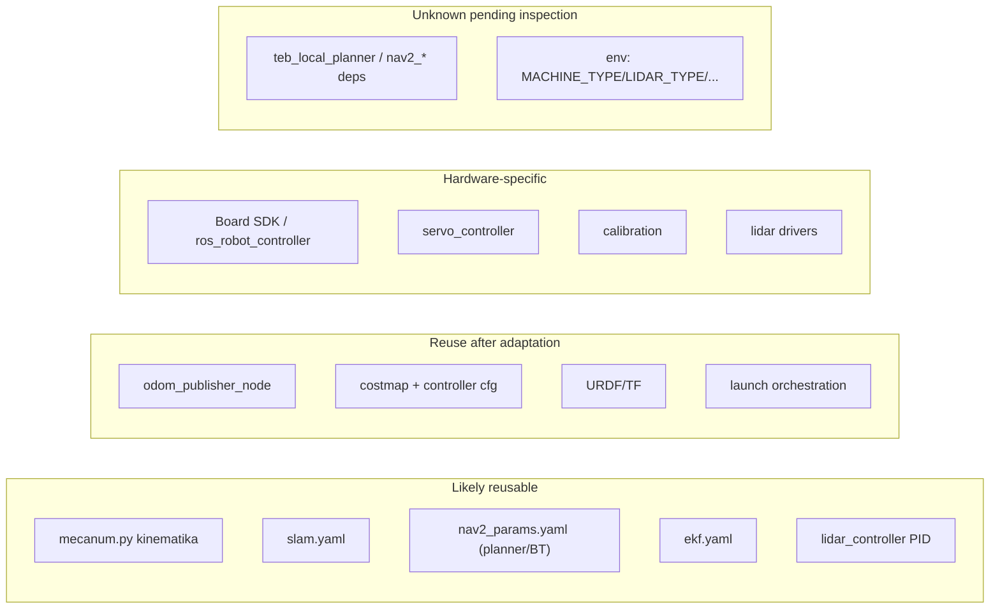

# Reuse & Adaptation (Phase 3)

> Audit statis. Label: `TERBUKTI DARI SOURCE`, `INFERENSI`, `BELUM TERVERIFIKASI`.
> Tujuan: klasifikasi komponen untuk robot mecanum kustom + rencana adaptasi bertahap.
> **Tidak** menetapkan pembelian hardware atau mengasumsikan sensor tersedia.

## Prinsip
Menyalin paket ROS 2 **tidak** menjamin fitur berjalan di robot lain. Klasifikasi di bawah
berdasarkan ketergantungan pada: topik, frame, parameter, interface pesan, SDK board, driver sensor,
dan asumsi mekanik.

## E.1 Klasifikasi komponen

### A. Likely reusable (alogritma/logika relatif independen hardware)

| Komponen | Sumber | Bukti | Catatan |
|---|---|---|---|
| Kinematika mecanum (`set_velocity`) | `src/driver/controller/controller/mecanum.py` | Rumus roda (baris 46–50) murni matematis | Butuh verifikasi konvensi arah fisik |
| SLAM 2D config (`slam_toolbox`) | `src/slam/config/slam.yaml` | Param generik (odom/map/base_footprint, scan_raw) | Frame/topik mungkin perlu disesuaikan |
| Nav2 params (planner NavFn, behavior, smoother, velocity_smoother) | `src/navigation/config/nav2_params.yaml` | Param standar Nav2 | Butuh penyesuaian footprint/radius |
| Behavior tree struktur recovery | `config/behavior_trees/*.xml` | BT standar Nav2 | Node `BackUp`/`Spin` bergantung kinematik |
| EKF fusion config | `src/driver/controller/config/ekf.yaml` | Param `robot_localization` standar | Sumber input perlu disesuaikan |
| Avoidance reaktif PID | `src/app/app/lidar_controller.py` | Logika threshold+PID (baris 149–276) | Independen hardware (butuh format scan) |

### B. Reusable after adaptation (butuh perubahan topik/frame/param/interface)

| Komponen | Sumber | Adaptasi yang diperlukan | Bukti |
|---|---|---|---|
| `odom_publisher_node` | `controller/odom_publisher_node.py` | Topik (`controller/cmd_vel`,`cmd_vel`,`odom_raw`), frame, faktor koreksi | `:133,:138,:142,:144,:246` |
| Model peta + AMCL config | `nav2_params.yaml` | `robot_radius`, frame, `scan_topic` | `:143,:189,:40` |
| DWB/TEB controller config | `nav2_controller_*.yaml` | Aktifkan/nonaktifkan `vy` bila ingin strafing; `robot_radius` | `max_vel_y:0.0` (:52–54) |
| Costmap config | `nav2_params.yaml` | Sumber scan, range, inflasi per robot | `:144–213` |
| TF/URDF | `simulations/landerpi_description/urdf/*` | Geometri & frame robot sendiri | `mecanum.xacro` |
| Launch orkestrasi | `navigation/launch/*`, `slam/launch/*` | Namespace/env, path map, BT XML hardcoded | `navigation.launch.py:35–39` |
| App transport (BasicNavigator) | `example/navigation_transport/navigation_transport.py` | Topik goal; titik pick/place | `:19,:33,:39` |

### C. Hardware-specific (SDK board/motor/protokol/sensor/kalibrasi)

| Komponen | Sumber | Ketergantungan | Bukti |
|---|---|---|---|
| Board SDK | `driver/ros_robot_controller/ros_robot_controller/ros_robot_controller_sdk.py` | Protokol serial STM32 (`serial`, `struct`), USB ttyACM0 | udev rules `99-ttyACM0.rules` |
| Node `ros_robot_controller` | `ros_robot_controller_node.py` | `Board()`, `set_motor_speed`, IMU/joy/battery | `:32,:69,:165` |
| Servo controller | `driver/servo_controller/*` | Servo bus (arm/steering), offset YAML | `controller_manager.py` |
| Kalibrasi roda/angular | `calibration/*` | Faktor koreksi robot fisik | `calibrate_params.yaml` |
| LiDAR driver | `peripherals/launch/include/{ldlidar_LD19,ms200_scan}.launch.py` | Perangkat LiDAR spesifik (`/dev/ldlidar`) | param `port_name` |
| Depth camera driver | `peripherals/launch/include/{ascamera,aurora930,...}` | Kamera spesifik (`DEPTH_CAMERA_TYPE`) | `depth_camera.launch.py:12` |

### D. Unknown pending hardware inspection

| Item | Alasan | Bukti/Sumber |
|---|---|---|
| Ketersediaan `teb_local_planner` | Default `use_teb=true` tetapi paket tidak dideklarasikan | `navigation.launch.py:23` |
| Ketersediaan `nav2_*`, `slam_toolbox`, `rtabmap`, `robot_localization`, `nav2_simple_commander` | Tidak dideklarasikan di `package.xml` | `navigation/package.xml`, `slam/package.xml` |
| Nilai `MACHINE_TYPE`, `LIDAR_TYPE`, `DEPTH_CAMERA_TYPE`, `need_compile`, `HOST`, `MASTER` | Hanya dibaca, tak di-set di repo | lintas launch |
| Apakah `odom_rf2o` benar-benar aktif | `rf2o` bukan bagian `controller.launch.py` default | `rf2o_laser_odometry.launch.py` |
| Geometri aman robot (radius/inflasi) | Butuh dimensi fisik | `robot_radius:0.10`, `inflation_radius:0.16` |

## E.2 Catatan inkonsistensi yang ditemukan
1. **TEB sebagai default** (`use_teb=true`) padahal `teb_local_planner` tidak dideklarasikan →
   berisiko gagal load controller di environment tanpa paket itu. `TERBUKTI DARI SOURCE`.
2. **Tidak ada gerak lateral** pada DWB (`max_vel_y:0.0`) maupun TEB → mecanum dipakai sebagai
   robot diferensial. `TERBUKTI DARI SOURCE`.
3. **`robot_radius 0.10` vs TEB `footprint radius 0.05`** → ketidakkonsistenan geometri. `TERBUKTI DARI SOURCE`.
4. **`local_costmap` punya blok `static_layer` yang tidak terdaftar di `plugins`** → tidak aktif. `TERBUKTI DARI SOURCE`.
5. **Odometri roda open-loop** (`odom_raw` integrasi perintah) → rentan drift. `TERBUKTI DARI SOURCE` (Phase 1–2).

## E.3 Rencana adaptasi bertahap

Setiap tahap: Objective · Prerequisites · Reuse · Adaptation · Success criteria · Failure & rollback.

### Tahap 1 — Identifikasi hardware & lingkungan target
- **Objective**: tetapkan model Raspberry Pi, OS, distro ROS 2, sensor, motor controller.
- **Prerequisites**: akses ke robot kustom; dokumentasi/`lsusb`/`/dev`.
- **Reuse**: konsep pemisahan driver (`peripherals`) vs kontrol (`controller`).
- **Adaptation**: petakan setara `MACHINE_TYPE`/`LIDAR_TYPE`/`DEPTH_CAMERA_TYPE` kustom.
- **Success**: daftar hardware + distro terkonfirmasi.
- **Failure/rollback**: jika distro ≠ Humble, sesuaikan versi Nav2; tidak ada rollback (info saja).

### Tahap 2 — Verifikasi kontrol motor & konvensi arah mecanum
- **Objective**: perintah Twist → roda benar (maju/mundur/strafing/putar).
- **Prerequisites**: Tahap 1; akses SDK motor kustom.
- **Reuse**: `mecanum.py#set_velocity` (rumus), pola `odom_publisher_node` (subscribe `cmd_vel`).
- **Adaptation**: ganti `Board.set_motor_speed` dengan SDK motor sendiri; verifikasi tanda
  `[-motor1,-motor2,motor3,motor4]` (`mecanum.py:50`) terhadap pemasangan roda.
- **Success**: roda berputar sesuai perintah; robot mengangkat roda untuk uji arah.
- **Failure/rollback**: robot diam/arah salah → hentikan, perbaiki tanda/ID motor, ulangi.

### Tahap 3 — Verifikasi odometri & TF
- **Objective**: `odom_raw` dan TF `odom→base_footprint` konsisten.
- **Prerequisites**: Tahap 2; IMU (jika ada).
- **Reuse**: `odom_publisher_node.cal_odom_fun`, `ekf.yaml`.
- **Adaptation**: putuskan sumber odometri (encoder nyata **lebih baik** daripada open-loop);
  sesuaikan frame.
- **Success**: `odom` halus; TF tidak putus; robot didorong manual menghasilkan perubahan pose wajar.
- **Failure/rollback**: drift besar → tambahkan encoder/rf2o; jangan lanjut ke Nav2 sebelum stabil.

### Tahap 4 — Verifikasi sensor publishing & alignment TF
- **Objective**: LiDAR publishes `/scan` (atau `/scan_raw`) dengan frame benar & TF ke `base_link`.
- **Prerequisites**: Tahap 3; LiDAR.
- **Reuse**: pola `lidar.launch.py` + remap ke `scan_raw`.
- **Adaptation**: samakan nama topik dengan yang dikonsumsi costmap; pastikan `frame_id` terhubung.
- **Success**: `ros2 topic hz` stabil; RViz menampilkan scan sejajar; TF `lidar_frame` ada.
- **Failure/rollback**: scan miring/tidak ada TF → perbaiki URDF/static transform.

### Tahap 5 — Bring up Nav2 dengan peta minimal & parameter konservatif
- **Objective**: stack Nav2 aktif (lifecycle) dengan map kecil.
- **Prerequisites**: Tahap 3–4; map 2D.
- **Reuse**: `nav2_params.yaml`, `navigation_base.launch.py`, `localization.launch.py`, BT.
- **Adaptation**: set `use_teb=false` (pakai DWB bawaan Nav2) untuk mengurangi dependency;
  sesuaikan `robot_radius`, kecepatan (`max_velocity`), frame.
- **Success**: semua node lifecycle `active`; goal di RViz diproses.
- **Failure/rollback**: node gagal aktif → cek dependency/param; kembali ke mode teleop.

### Tahap 6 — Verifikasi observasi costmap
- **Objective**: obstacle ter-marking/clearing di costmap.
- **Prerequisites**: Tahap 5.
- **Reuse**: costmap config (voxel/obstacle + inflation).
- **Adaptation**: sesuaikan `obstacle_max_range`, `inflation_radius` untuk sensor & ukuran robot.
- **Success**: RViz costmap menampilkan obstacle statis & menghapus saat hilang.
- **Failure/rollback**: obstacle tak muncul → cek `scan_raw`, TF, `observation_sources`.

### Tahap 7 — Uji obstacle avoidance kecepatan rendah di area terkendali
- **Objective**: robot menghindari obstacle & mencapai goal tanpa tabrakan.
- **Prerequisites**: Tahap 6.
- **Reuse**: DWB/TEB + BT recovery; opsi `lidar_controller.py` reaktif sebagai fallback.
- **Adaptation**: turunkan `max_velocity`; aktifkan/kalibrasi ulang inflasi.
- **Success**: minimal N rute tanpa kontak; recovery berjalan saat buntu.
- **Failure/rollback**: kontak/osilasi → hentikan, perbesar inflasi/turunkan kecepatan, ulangi.

### Tahap 8 — Tambah mapping/localization atau perilaku lanjutan
- **Objective**: SLAM (slam_toolbox) atau rtabmap 3D + waypoint/transport.
- **Prerequisites**: Tahap 7 stabil.
- **Reuse**: `slam.yaml`, `slam_base.launch.py`, rtabmap launch, `navigation_transport.py`.
- **Adaptation**: sesuaikan depth camera & frame; hindari `map→odom` ganda.
- **Success**: peta konsisten; lokalisasi stabil; waypoint berikutnya bereaksi benar.
- **Failure/rollback**: konflik TF → jalankan AMCL **atau** SLAM, tidak keduanya.

## Diagram klasifikasi (ringkas)

## Kesimpulan
- `TERBUKTI DARI SOURCE`: pemisahan driver/kontrol/nav memudahkan porting **sebagian besar** logika.
- Bagian yang **wajib** diadaptasi: SDK motor, driver sensor, TF/URDF, dan nilai env.
- `BELUM TERVERIFIKASI`: seluruh asumsi hardware target — harus diverifikasi pada Tahap 1 sebelum
  mereplikasi konfigurasi.
